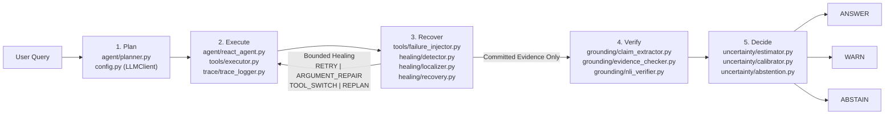

# TraceRecover

**An Evidence-Grounded Self-Healing and Uncertainty-Aware Framework for Reliable Tool-Augmented Large Language Model Agents**

TraceRecover is a reliability, self-healing, evidence-verification, and observability framework for tool-augmented AI agents. Every query passes through an auditable **5-layer pipeline** (`Plan → Execute → Recover → Verify → Decide`) that separates trusted `committed` evidence from `discarded` tool failures, heals runtime tool faults within strict budgets, grounds atomic claims against committed observations, and gates responses into **`ANSWER`**, **`WARN`**, or **`ABSTAIN`**.

---

## 1. Five-Layer Reliability Pipeline (`Plan → Execute → Recover → Verify → Decide`)



| Layer | Core Modules | Responsibility |
| :--- | :--- | :--- |
| **1. Plan** | `agent/planner.py` (`RuleBasedPlanner`), `config.py` (`LLMClient`) | Multi-step planning & multi-provider LLM interface (`local`, `gemini`, `openai`, `anthropic`) with token/cost tracking and automatic `404`/`429`/`503`/timeout failover. |
| **2. Execute** | `agent/react_agent.py` (`ReactAgent`), `tools/executor.py` (`ToolExecutor`), `trace/trace_logger.py` (`TraceLogger`) | AST/schema-validated tool execution (`calculator`, `python_exec`, `search`, `mock_api`) with explicit `committed` vs. `discarded` JSONL step provenance. |
| **3. Recover** | `tools/failure_injector.py` (`FailureInjector`), `healing/detector.py` (`FailureDetector`), `healing/localizer.py` (`FailureLocalizer`), `healing/recovery.py` (`RecoveryEngine`) | Deterministic fault injection, independent failure detection, root-cause step localization, and bounded recovery (`RETRY`, `ARGUMENT_REPAIR`, `TOOL_SWITCH`, `REPLAN`; `max_retries=1`, `max_total_attempts=4`). |
| **4. Verify** | `grounding/claim_extractor.py`, `grounding/evidence_checker.py` (`EvidenceChecker`), `grounding/nli_verifier.py` | Atomic factual claim extraction and entity-scoped NLI verification (DeBERTa-v3 NLI with deterministic offline fallback) strictly over committed steps. |
| **5. Decide** | `uncertainty/estimator.py` (`UncertaintyEstimator`), `uncertainty/calibrator.py`, `uncertainty/abstention.py` (`AbstentionPolicy`) | 4-signal trace reliability scoring (`grounding`, `tool_success`, `recovery_reliability`, `self_consistency`) and tri-state **`ANSWER` / `WARN` / `ABSTAIN`** gating. |

---

## 2. Flagship 100-Task Benchmark Results (`seed = 42`)

Verified from `results/phase8-run-20261123T183333634001Z/` (`dataset_version = 2.0`, `100` multi-hop tasks: `70` answerable + `30` abstention-required, `n = 300` paired runs across `0%`, `20%`, and `40%` injected tool faults):

| Fault Rate | Baseline ReAct Success | **TraceRecover Success** | Baseline Hallucination | **TraceRecover Hallucination** | **Validated Self-Healing** |
| :---: | :---: | :---: | :---: | :---: | :---: |
| **0%** | `86.0%` | **`100.0%`** | `13.1%` | **`0.0%`** | `—` *(clean regime)* |
| **20%** | `58.0%` | **`89.0%`** | `40.4%` | **`0.0%`** | **`52.4%`** (`22/42`) |
| **40%** | `40.0%` | **`79.0%`** | `57.6%` | **`0.0%`** | **`50.7%`** (`35/69`) |

- **Statistical Significance (Pooled `n = 300`):** Paired McNemar exact two-sided **`p = 1.03 × 10⁻²⁵`** (`+84` net TraceRecover wins, **`0` regressions**).
- **Calibration & Zero-Leakage Cross-Fitting:** Pooled Brier Score = **`0.165`** · 10-bin ECE = **`0.212`** · 5-fold group-by-`task_id` out-of-fold strict selective accuracy = **`99.4%`** (`178/179`, `abstain_recall = 100.0%`).
- **Component Ablations (`0% / 20% / 40%` success):** `without_grounding` (`90% / 79% / 70%`, `11.1–14.9%` hallucination), `without_uncertainty` (`80% / 69% / 57%`, `20.0–43.0%` hallucination), `without_localization` (`100% / 73% / 53%`, `0.0%` recovery).

---

## 3. Selective Gating: `ANSWER` / `WARN` / `ABSTAIN`

`AbstentionPolicy` combines hard safety gates with calibrated uncertainty thresholds (default `answer_threshold = 0.15`, `abstain_threshold = 0.55`):

- **`ANSWER` (`U < 0.15`):** All factual claims are supported by committed tool evidence with zero contradictions and high trace reliability.
- **`WARN` (`0.15 ≤ U < 0.55`):** Answer is returned with an explicit uncertainty or resilience-fallback disclosure (e.g., partial recovery or automatic 503 web-search fallback).
- **`ABSTAIN` (`U ≥ 0.55` or Hard Safety Gate):** Triggered automatically whenever **any claim contradicts committed evidence**, **zero claims have usable supporting evidence**, or recovery is exhausted—preventing hallucinations on missing-entity or contradiction traps.

---

## 4. API vs. Offline / Local Execution

TraceRecover supports both **zero-key deterministic local execution** and **live remote LLM providers**:

- **Offline / Local Mode (`provider="local"`):**
  - Runs 100% deterministically on all 100 benchmark tasks, all 4 Live Demo reliability presets (`Normal Grounded ANSWER`, `40% Fault + Self-Healing`, `Missing Evidence ABSTAIN`, `Contradiction Guard`), arithmetic expressions (`calculator` / `python_exec`), and TraceRecover identity queries.
  - For arbitrary open-domain questions in Live Demo, safely falls back to `ExternalSearchAdapter` (Wikipedia/DuckDuckGo) with HTML unescaping while keeping missing-entity traps (`unobtainium-999`, `T-999`) strictly abstaining.
- **Live Remote LLM Mode (`gemini`, `openai`, `anthropic`):**
  - Configure keys either in `.env` (copy `.env.example` → `.env`, auto-loaded at startup) or directly from the collapsible **API Keys & Model Provider** card in **2. Live Demo** (`POST /api/keys`, server-side only, masked `****XXXX` in `GET /api/health` and `GET /api/settings`).
  - `LLMClient` (`config.py`) includes automatic `404`/`429`/`503`/timeout failover across fast Gemini models (`gemini-2.5-flash-lite` → `gemini-3.5-flash-lite` → `gemini-3.8-flash` → `gemini-3.6-flash` → `gemini-2.5-flash`), and `web_dashboard.py` degrades gracefully to web synthesis (`200 OK`, `WARN`) if all upstream models experience a temporary 503 outage.

---

## 5. Standalone 4-Bit QLoRA Fine-Tuning Extension (`finetuning/`)

To distill TraceRecover's recovery policy into a lightweight learned adapter without modifying the deterministic engine:

- **`finetuning/prepare_qlora_dataset.py`:** Builds an 80/20 **task-grouped** split (`seed = 42`, **`0` task overlap**) from `data/tracerecover_step_level_telemetry.csv`:
  - `data/qlora_train.jsonl`: **`934` examples** (`80` unique tasks)
  - `data/qlora_val.jsonl`: **`235` examples** (`20` unique tasks)
- **`finetuning/train_qlora_policy.py`:** 4-bit NF4 QLoRA configuration targeting **`Qwen/Qwen2.5-7B-Instruct`** (`r = 16`, `lora_alpha = 32`, `lora_dropout = 0.05`, `lr = 2e-4`, cosine schedule, `3` epochs, `7` projection modules) with CPU `--dry-run` validation (**`40,370,176` trainable LoRA parameters / `0.5273%`**).

---

## 6. Quick Start & Commands

### Setup (Windows PowerShell)

```powershell
python -m venv venv
.\venv\Scripts\Activate.ps1
python -m pip install --upgrade pip
python -m pip install -r requirements.txt
Copy-Item .env.example .env
```

### Run Web Dashboard (6-Page Material Design 3 UI)

```powershell
.\venv\Scripts\python.exe -m uvicorn web_dashboard:app --host 127.0.0.1 --port 8000
```

Open **`http://127.0.0.1:8000`** to access: **1. Overview**, **2. Live Demo**, **3. Results & Charts**, **4. Datasets**, **5. Execution Logs**, and **6. Research Report** (CSV/JSON/PDF export).

### Run Tests, Benchmarks & QLoRA Dry-Run

```powershell
# Run core engine + dashboard + LLM client test suite
.\venv\Scripts\python.exe -m pytest tests/test_abstention.py tests/test_calibrator.py tests/test_claim_extractor.py tests/test_detector.py tests/test_evaluation.py tests/test_evidence_checker.py tests/test_executor.py tests/test_failure_injector.py tests/test_llm_client.py tests/test_localizer.py tests/test_metrics.py tests/test_nli_verifier.py tests/test_phase1.py tests/test_phase8_evaluation_tools.py tests/test_recovery.py tests/test_uncertainty.py tests/test_web_dashboard.py -v

# Reproduce flagship 100-task benchmark (seed 42)
.\venv\Scripts\python.exe -m eval.run_all --seed 42

# Regenerate & dry-run validate QLoRA recovery-policy dataset
.\venv\Scripts\python.exe finetuning\prepare_qlora_dataset.py
.\venv\Scripts\python.exe finetuning\train_qlora_policy.py --dry-run
```

---

## 7. Teammate Tasks & Handoff Checklist

Use this repository (or the generated `TraceRecover_teammate_handoff.zip` archive) to execute the remaining collaborative tasks cleanly without modifying the protected core reliability layers (`agent/`, `grounding/`, `healing/`, `uncertainty/`, `tools/`, `trace/`):

1. **GPU Fine-Tuning of QLoRA Recovery Policy (`finetuning/`):**
   - Run `finetuning/train_qlora_policy.py` on a CUDA GPU (e.g., Google Colab T4/A100 or local NVIDIA GPU) with `torch`, `transformers`, `peft`, `bitsandbytes`, and `datasets` installed using `data/qlora_train.jsonl` (`934` examples) and `data/qlora_val.jsonl` (`235` examples).
   - Evaluate validation accuracy & macro-F1 on `failure_type` and `recovery_action` prediction; keep model weights (`*.safetensors`, `checkpoints/`, `adapters/`, `outputs/`) out of Git (already ignored in `.gitignore`).
2. **Presentation Deck & Viva Preparation (`docs/`):**
   - Review [docs/TraceRecover_Results_Evaluation_Slides.pptx](docs/TraceRecover_Results_Evaluation_Slides.pptx) and the 2× Retina PNG graphs in `results/phase8-run-20261123T183333634001Z/plots/png/`.
   - Use [docs/TRACERECOVER_COMPLETE_PROJECT_HANDOFF.md](docs/TRACERECOVER_COMPLETE_PROJECT_HANDOFF.md) and [docs/FINAL_PROJECT_REPORT.md](docs/FINAL_PROJECT_REPORT.md) for final report submission and faculty viva Q&A.
3. **Optional Live Commercial LLM Evaluation:**
   - Add your own `GEMINI_API_KEY`, `OPENAI_API_KEY`, or `ANTHROPIC_API_KEY` into local `.env` (never commit `.env`) and test live questions in **2. Live Demo** alongside the 4 deterministic reliability presets.
4. **Update Legacy Browser E2E Tests (Optional):**
   - The 11 legacy multi-tab Playwright E2E tests (`test_browser_e2e.py`, `test_phase3_browser_e2e.py`, etc.) still reference removed developer tabs from the earlier 13-tab UI; update them if full browser E2E coverage of the streamlined 6-page Material Design 3 dashboard is desired.
