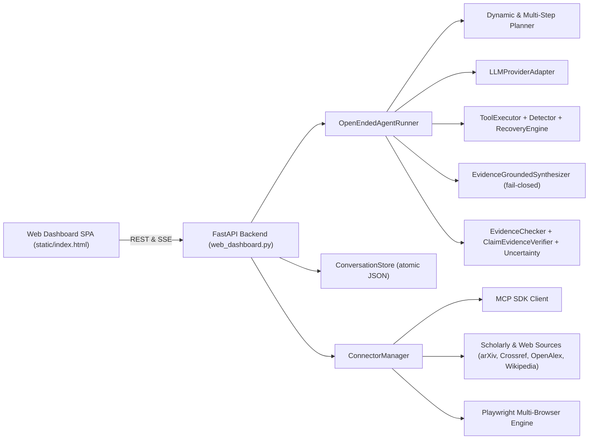

# TraceRecover

**An Evidence-Grounded Self-Healing and Uncertainty-Aware Framework for Reliable Tool-Augmented Large Language Model Agents**

TraceRecover is a B.Tech capstone reliability, evidence-verification, and observability platform for tool-augmented AI agents. It executes multi-step tool/research workflows with step-level trace logging, detects and localizes tool failures, performs bounded self-healing recovery, extracts provenance-preserving factual claims, verifies every claim independently against retrieved evidence with context-aware contradiction detection, estimates uncertainty, and abstains honestly when evidence is insufficient or synthesis fails.

---

## Problem Statement

Tool-augmented LLM agents frequently fail silently in real workflows: tools return timeouts, malformed schemas, or incorrect values; synthesized answers mix claims from incompatible studies or fabricate unsupported citations; and provider outages are often masked by silent fallbacks. TraceRecover addresses these reliability gaps by enforcing deterministic provenance tracking (`COMMITTED` vs. `DISCARDED` tool outputs), detector-validated recovery, provenance-preserving claim verification, fail-closed synthesis integrity, and calibrated `ANSWER` / `WARN` / `ABSTAIN` decision policies.

---

## System Architecture



- **`web_dashboard.py` & `static/index.html`:** FastAPI REST/SSE backend (57 routes), security middleware (CORS, CSP/HSTS headers, chunked-safe request-size caps, sliding-window rate limits, optional admin Bearer/`X-API-Key` guard), mtime-validated artifact caching, operational `/api/health`, and a 13-view light-theme SPA.
- **`agent/`:** `OpenEndedAgentRunner` (10-stage pipeline + 7-stage timing telemetry + redacted structured logging), `DynamicQueryPlanner`, `MultiStepResearchPlanner`, `LLMProviderAdapter`, `EvidenceGroundedSynthesizer` (`SynthesisFailureError`, zero silent live fallback), `ConversationStore` (atomic JSON + mtime summary cache), and core `ReactAgent`.
- **`grounding/`, `healing/`, `uncertainty/`, `tools/`, `trace/`:** Protected core reliability stack covering claim extraction, evidence grounding, optional DeBERTa NLI, fault injection, failure detection/localization, bounded recovery (`RETRY`, `ARGUMENT_REPAIR`, `TOOL_SWITCH`, `REPLAN`), uncertainty estimation, abstention policy, and JSONL trace logging.
- **`connectors/`:** `ConnectorManager`, `PermissionEngine` (SSRF/DNS-rebinding defense, allowlists, approval gates, untrusted-data framing), Fernet `SecretVault`, MCP SDK client, trust-tiered scholarly registry, and Playwright browser automation.
- **`eval/`, `data/`, `results/`:** Canonical 100-task benchmark (`eval/tasks.json`), frozen 92-question Phase 7.4 holdout (`data/phase7_4_independent_holdout.json`), Phase 8.2 performance harness (`eval/phase8_2_performance.py`), statistical validation, and preserved experiment runs.

---

## Main Features

- **10-Stage Verifiable Execution Pipeline** with live Server-Sent Events (SSE) progress and replayable JSONL traces.
- **Provenance-Preserving Claim Verification & Context-Aware Contradiction Detection** distinguishing differing independent studies from true single-experiment logical contradictions.
- **Fail-Closed Execution Integrity:** Zero silent live-to-deterministic synthesis fallback; preserves retrieved connector evidence on post-retrieval synthesis failure and labels runs honestly.
- **Self-Healing Tool Recovery:** Automated detection, root-cause localization, and bounded multi-strategy recovery with detector re-validation before committing evidence.
- **Connect Hub & Research Ecosystem:** Trust-tiered academic/reference connectors, Playwright browser inspector with SSRF guards, universal MCP SDK client, and encrypted server-side secret vault.
- **Observability & Persistent Conversations:** Redacted structured JSON logs (`tracerecover.observability`), per-stage latency breakdowns, 5-subsystem `/api/health`, and atomic disk-backed conversation threads surviving page reloads and server restarts (with zero `localStorage`/`sessionStorage` usage).

---

## Technologies

- **Backend:** Python 3.12+ (verified on Python 3.14.4), FastAPI, Uvicorn, Pydantic v2, HTTPX, ReportLab (PDF export), `cryptography` (Fernet), Official MCP Python SDK.
- **Frontend:** Vanilla HTML5/CSS3/ES2022 single-file SPA (`static/index.html`) with inline SVG charts and SSE streaming (zero frontend build step required).
- **Browser Automation & Testing:** Playwright (Chromium/Firefox/WebKit detection & Chromium E2E), Pytest (`226` automated tests).
- **Packaging:** Dockerfile (`python:3.12-slim`, non-root user), `docker-compose.yml` (loopback-bound), `render.yaml`.

---

## Installation

### Windows (PowerShell)

```powershell
# 1. Create and activate a virtual environment (Python 3.12+)
python -m venv venv
.\venv\Scripts\Activate.ps1

# 2. Install runtime and test dependencies
python -m pip install --upgrade pip
python -m pip install -r requirements.txt

# 3. (Optional) Install Playwright for browser automation and Chromium E2E tests
python -m pip install "playwright>=1.48,<2.0"
```

### Linux / macOS (Bash)

```bash
python3 -m venv venv
source venv/bin/activate
python -m pip install --upgrade pip
python -m pip install -r requirements.txt

# Optional for browser automation and E2E tests:
python -m pip install "playwright>=1.48,<2.0"
```

---

## Configuration

Copy `.env.example` to `.env` for local overrides (`.env` is git-ignored — **never commit real credentials**):

```powershell
# Windows PowerShell
Copy-Item .env.example .env
```
```bash
# Linux / macOS
cp .env.example .env
```

| Variable | Default | Purpose |
|---|---|---|
| `LLM_PROVIDER` | `local` | Default provider (`local`, `gemini`, `openai`, `anthropic`, `ollama`, `local_openai`). |
| `GEMINI_API_KEY`, `OPENAI_API_KEY`, `ANTHROPIC_API_KEY` | *(empty)* | Optional server-side remote LLM keys (kept strictly server-side). |
| `OLLAMA_BASE_URL`, `LOCAL_LLM_BASE_URL` | *(empty)* | Optional local OpenAI-compatible model server endpoints. |
| `TRACERECOVER_ADMIN_TOKEN` | *(empty)* | Enables Bearer/`X-API-Key` auth on admin/mutation routes (**required before public exposure**). |
| `TRACERECOVER_VAULT_KEY` | *(empty)* | Encryption key for connector `SecretVault` (**required via secret manager in production**). |
| `TRACERECOVER_CORS_ORIGINS` | `http://127.0.0.1:8000,http://localhost:8000` | Comma-separated allowed CORS origins. |
| `TRACERECOVER_ENABLE_DOCS` | `true` (`false` in Docker/Render) | Enables/disables Swagger UI (`/docs`). |
| `TRACERECOVER_MAX_REQUEST_BYTES` | `65536` | Request body size cap (enforced on both `Content-Length` and chunked bodies). |
| `TRACERECOVER_RATE_LIMIT_RUN` / `_EXPERIMENTS` | `60` / `10` | Per-IP requests per minute. |

---

## Local Startup & Dashboard Usage

### Start the Web Dashboard

```powershell
# Windows PowerShell
.\venv\Scripts\python.exe -m uvicorn web_dashboard:app --host 127.0.0.1 --port 8000 --proxy-headers
```
```bash
# Linux / macOS
./venv/bin/python -m uvicorn web_dashboard:app --host 127.0.0.1 --port 8000 --proxy-headers
```

1. Verify health: `http://127.0.0.1:8000/api/health`
2. Open dashboard: `http://127.0.0.1:8000`
3. Use **Query Workspace** to create persistent threads, run queries, inspect 10-stage timelines, view claim verification, and check execution integrity/timings. Use **Live Runner** for the 6 one-click reliability presets, **Trace Replay** for step-by-step provenance playback, and **Connect Hub** for connectors and scholarly search.

See [docs/TRACE_RECOVER_FINAL_DEMO_GUIDE.md](docs/TRACE_RECOVER_FINAL_DEMO_GUIDE.md) for a step-by-step zero-API-key capstone demonstration script.

### Start via CLI (Offline Mode)

```powershell
.\venv\Scripts\python.exe app.py --provider local --question "What is the capital of France?"
.\venv\Scripts\python.exe app.py --provider local --failure-rate 40 --seed 42
```

---

## Execution Modes

- **`OFFLINE` (`provider="local"`):** Fully deterministic local tools and synthesizer; zero API keys or network calls required.
- **`LIVE CONNECTOR`:** Local deterministic planner/synthesizer paired with live external/scholarly connectors (`arXiv`, `Crossref`, `OpenAlex`, `Wikipedia`) or Playwright inspection.
- **`MOCK`:** Deterministic test LLM clients or mock search adapters (explicitly labeled `MOCK`, never `LIVE LLM`).
- **`LIVE LLM` / `LIVE CONNECTOR + LIVE LLM`:** Supported official providers (`gemini`, `openai`, `anthropic`, `ollama`, `local_openai`). Fails closed (`HTTP 503` / `missing_credentials`) when unconfigured and preserves retrieved evidence without silent fallback if synthesis fails.

---

## Live LLM Activation Status

**Deliberately Deferred (Currently Unconfigured):** No external LLM API credentials or local model server endpoints are configured in this submission workspace. All engineering, security, observability, performance, and browser E2E validations run in **OFFLINE** and **MOCK** modes with zero fabricated provider responses. When ready to activate live inference, add `GEMINI_API_KEY` (or another supported provider key / `OLLAMA_BASE_URL`) to `.env` and restart Uvicorn.

---

## Evaluation & Test Commands

All tests and benchmarks run without external API credentials:

```powershell
# Full repository test suite (226 tests, including 10 Chromium Playwright E2E suites)
.\venv\Scripts\python.exe -m pytest -v

# Reproducible Phase 8.2/8.3 performance, concurrency, storage & dashboard benchmark
.\venv\Scripts\python.exe eval/phase8_2_performance.py --label local-check

# Canonical 100-task offline benchmark evaluation + SVG plots
.\venv\Scripts\python.exe -m eval.run_all --seed 42
```

**Latest Verified Full Test Suite Result (Phase 8.3):** **`226 passed, 0 failed, 0 skipped`** (`106.74s`), including all `10/10` real Chromium Playwright E2E suites.

---

## Deployment Limitations

- **Local containerization:** `Dockerfile` and `docker-compose.yml` (loopback-bound `127.0.0.1:8000:8000`) are validated statically (`docker-compose config --quiet` exit `0`), but a live `docker build` was not executed because Docker Engine was stopped on the host.
- **Single-node scope:** Atomic filesystem JSON persistence and in-memory rate limiting are designed for single-process demos; multi-worker public deployments require PostgreSQL/Redis, TLS termination, `TRACERECOVER_ADMIN_TOKEN`, `TRACERECOVER_VAULT_KEY`, and cryptographic user authentication.

See [docs/TRACE_RECOVER_KNOWN_LIMITATIONS.md](docs/TRACE_RECOVER_KNOWN_LIMITATIONS.md) and [docs/PHASE8_3_DEPLOYMENT_VALIDATION.md](docs/PHASE8_3_DEPLOYMENT_VALIDATION.md) for complete details.

---

## Documentation Index

- **Final Completion & Demo (Phase 8.3):**
  - [PHASE8_3_FINAL_REPORT.md](PHASE8_3_FINAL_REPORT.md)
  - [Final Capstone Demo Guide](docs/TRACE_RECOVER_FINAL_DEMO_GUIDE.md)
  - [Deployment Validation](docs/PHASE8_3_DEPLOYMENT_VALIDATION.md)
  - [Known Limitations](docs/TRACE_RECOVER_KNOWN_LIMITATIONS.md)
- **Performance, Observability & Security (Phases 8.1–8.2):**
  - [PHASE8_2_FINAL_REPORT.md](PHASE8_2_FINAL_REPORT.md) · [Performance Analysis](docs/PHASE8_2_PERFORMANCE_ANALYSIS.md) · [Observability Architecture](docs/PHASE8_2_OBSERVABILITY_ARCHITECTURE.md) · [Reliability Testing](docs/PHASE8_2_RELIABILITY_TESTING.md)
  - [PHASE8_1_FINAL_REPORT.md](PHASE8_1_FINAL_REPORT.md) · [System Architecture](docs/PHASE8_1_SYSTEM_ARCHITECTURE.md) · [Security Audit](docs/PHASE8_1_SECURITY_AUDIT.md) · [Deployment Readiness](docs/PHASE8_1_DEPLOYMENT_READINESS.md)
- **Research Engine, Provenance & Historical Evaluations (Phases 1–7.5.3):**
  - [Execution Integrity (Phase 7.5.2)](docs/PHASE7_5_2_EXECUTION_INTEGRITY.md) · [Live Activation Log (Phase 7.5.3)](docs/PHASE7_5_3_LIVE_EXECUTION.md)
  - [Independent Holdout Evaluation (Phase 7.4)](docs/PHASE7_4_RELIABILITY_EVALUATION.md) · [Claim Provenance](docs/CLAIM_PROVENANCE_ARCHITECTURE.md) · [Context-Aware Contradictions](docs/CONTEXT_AWARE_CONTRADICTION_VERIFICATION.md)
  - [Connector & MCP Guide](docs/CONNECTOR_GUIDE.md) · [Browser Automation](docs/BROWSER_AUTOMATION.md) · [Security Architecture](docs/SECURITY.md) · [Viva Preparation](docs/viva_preparation.md)
