# TraceRecover: An Evidence-Grounded Self-Healing and Uncertainty-Aware Framework for Reliable Tool-Augmented Large Language Model Agents

**Capstone Project Technical Report**  
**Workspace:** `C:\tracerecover`  
**Flagship Benchmark Run:** `phase8-run-20261123T183333634001Z` (100 tasks, `dataset_version=2.0`, `seed=42`)  
**Dataset Integrity SHA-256:** `7e3a535c6609021ace84acc86e62fbc641ca6f567feac77a2d5b457f61f5050c`

---

## 1. Executive Summary & Problem Statement

Tool-augmented Large Language Model (LLM) agents extend language models beyond static parametric knowledge by invoking external tools—such as calculators, search engines, structured databases, Python sandboxes, and academic connectors—to answer multi-hop queries. In real-world deployments, however, tool-augmented agents suffer from four coupled reliability failures:

1. **Silent Tool Fault Propagation:** Transient timeouts, malformed arguments, empty payloads, and corrupted tool outputs (`wrong_output`) propagate unchecked into downstream reasoning steps and final responses.
2. **Evidence-Unaware Hallucination:** When tool execution fails or returns incomplete evidence, standard agents fabricate plausible-sounding answers rather than verifying individual factual claims against committed tool observations.
3. **Uncontrolled Self-Healing Loops:** Naive retry mechanisms risk infinite loops, mask unrecovered errors, or fail to separate discarded failed attempts from committed provenance.
4. **Overconfident Emission on Unanswerable Queries:** Without calibrated uncertainty quantification and principled selective abstention, agents emit confident answers even when evidence is contradictory, missing, or unverified.

**TraceRecover** addresses these four failure modes through a modular, five-layer architecture that couples provenance-tracked tool execution, bounded fault localization and recovery, claim-level evidence grounding, and four-signal uncertainty-gated selective abstention (`ANSWER` / `WARN` / `ABSTAIN`).

Across a reproducible 100-task multi-hop benchmark evaluated under `0%`, `20%`, and `40%` deterministic tool-fault injection (`n = 300` paired executions, `seed = 42`), TraceRecover achieves:

- **Task Success Rate:** `100.0%` at `0%` faults (vs. `86.0%` baseline), `89.0%` at `20%` faults (vs. `58.0%` baseline), and `79.0%` at `40%` faults (vs. `40.0%` baseline).
- **Pooled Reliability Gain:** `89.3%` (`268/300`) vs. `61.3%` (`184/300`) baseline—a net gain of **+84 tasks** with **0 regressions** (`baseline_only = 0`), yielding a pooled exact two-sided paired McNemar test value of **`p = 1.03 × 10⁻²⁵`**.
- **Zero Gold-Fact Hallucinations:** `0.0%` hallucination rate across all three fault regimes (`0/70`, `0/60`, `0/49` claim-bearing answers), compared to `13.1%`, `40.4%`, and `57.6%` for the unprotected baseline.
- **Leakage-Free Selective Accuracy:** `99.4%` (`178/179`) out-of-fold strict selective accuracy under 5-fold group-by-`task_id` cross-fitting (`abstain_recall = 100.0%`, `abstain_f1 = 85.3%`).
- **Validated Bounded Recovery:** `52.4%` (`22/42`) at `20%` faults and `50.7%` (`35/69`) at `40%` faults via bounded retries, argument repair, and cross-tool switching.

---

## 2. Five-Layer System Architecture

TraceRecover enforces strict separation of concerns across five execution and verification layers while maintaining full step-level provenance (`committed` vs. `discarded` steps):

```mermaid
flowchart LR
    Q["User Query"] --> L1["Layer 1: Planning<br/>agent/planner.py<br/>config.py"]
    L1 --> L2["Layer 2: Provenance Execution<br/>agent/executor.py<br/>tools/"]
    L2 --> L3["Layer 3: Fault Detection & Healing<br/>healing/detector.py<br/>healing/localizer.py<br/>healing/recovery.py"]
    L3 -- "Bounded Recovery<br/>(Retry / Repair / Switch)" --> L2
    L3 -- "Committed Trace Only" --> L4["Layer 4: Claim Grounding<br/>grounding/claim_extractor.py<br/>grounding/nli_verifier.py<br/>grounding/evidence_checker.py"]
    L4 --> L5["Layer 5: Uncertainty & Abstention<br/>uncertainty/signals.py<br/>uncertainty/calibrator.py<br/>uncertainty/abstention.py"]
    L5 --> OUT["Final Decision<br/>ANSWER / WARN / ABSTAIN"]
```



### Module Inventory

| Layer | Responsibility | Core Modules |
| :--- | :--- | :--- |
| **Layer 1: Planning & LLM Interface** | Multi-step task decomposition (`RuleBasedPlanner`, `DatasetTaskPlanner`) and multi-provider LLM abstraction (`local`, Gemini, OpenAI, Anthropic) with token, latency, and USD cost tracking. | `agent/planner.py`, `config.py`, `agent/synthesizer.py` |
| **Layer 2: Provenance-Tracked Execution** | Deterministic tool execution across `calculator`, `python_exec`, `search`, `database`, and `file_reader`, maintaining explicit `committed` vs. `discarded` step provenance and reproducible fault injection. | `agent/executor.py`, `agent/trace.py`, `tools/`, `eval/failure_injector.py` |
| **Layer 3: Self-Healing Engine** | Taxonomy-driven fault detection (`timeout`, `empty_result`, `bad_arguments`, `wrong_output`, `tool_crash`), root-cause step localization, and bounded recovery strategies (`RETRY`, `ARGUMENT_REPAIR`, `TOOL_SWITCH`, `REPLAN`, `ABSTAIN`). | `healing/detector.py`, `healing/localizer.py`, `healing/recovery.py` |
| **Layer 4: Evidence Grounding** | Atomic factual claim extraction, entity-scoped Natural Language Inference (DeBERTa-v3 NLI with deterministic offline lexical/numerical fallback), and context-aware contradiction detection. | `grounding/claim_extractor.py`, `grounding/nli_verifier.py`, `grounding/evidence_checker.py` |
| **Layer 5: Uncertainty & Selective Abstention** | Four-signal uncertainty aggregation (tool failure rate, recovery penalty, grounding/contradiction risk, missing-evidence coverage), threshold calibration (`answer_threshold`, `abstain_threshold`), and tri-state policy gating (`ANSWER` / `WARN` / `ABSTAIN`). | `uncertainty/signals.py`, `uncertainty/calibrator.py`, `uncertainty/abstention.py` |

---

## 3. Materials & Methods

### 3.1 Benchmark Dataset (`data/eval_tasks.json`)

The frozen flagship evaluation suite (`dataset_version = 2.0`, SHA-256 `7e3a535c6609021ace84acc86e62fbc641ca6f567feac77a2d5b457f61f5050c`) contains **100 deterministic multi-hop tasks** spanning five operational categories:

- **70 Answerable Tasks:** Multi-hop search-plus-math queries, structured database-plus-calculation lookups, document file-reading extractions, and cross-tool verification chains with explicit gold facts.
- **30 Abstention-Required Tasks (`should_abstain = True`):** Missing-evidence lookups, non-existent entity queries, and contradictory-source probes where an honest agent must refuse rather than fabricate an answer.

### 3.2 Experimental Protocol & Fault Injection

Each of the 100 tasks is executed identically across both the **Baseline** (unprotected tool execution without healing, grounding, or abstention) and **TraceRecover** (full 5-layer pipeline), plus three single-component ablations (`without_grounding`, `without_uncertainty`, `without_localization`), under three deterministic fault rates:

- **0% Faults:** Clean tool environment (10 natural unanswerable/missing-tool-data events).
- **20% Faults:** Seeded (`seed = 42`) stochastic injection of `timeout`, `empty_result`, `bad_arguments`, and `wrong_output` across tool invocations.
- **40% Faults:** High-stress fault injection testing bounded recovery under compound multi-step disruption (including secondary recovery-attempt failures).

All 600 paired baseline/TraceRecover runs and 1,769 step-level events are logged to `data/tracerecover_execution_telemetry.csv` and `data/tracerecover_step_level_telemetry.csv`, with verified exact parity (`telemetry_csv_parity.parity_ok = True`, `0` mismatches).

### 3.3 Evaluation & Statistical Validation Metrics

- **Task Success Rate & Wilson 95% Confidence Intervals:** Exact binomial proportion CIs per fault condition (`n = 100`).
- **Paired McNemar Exact Two-Sided Test:** Paired comparison of binary task success on identical tasks and seeds (`n = 100` per fault rate; `n = 300` pooled).
- **Gold-Fact & NLI-Grounded Hallucination Rate:** Fraction of non-abstained, claim-bearing answers containing unsupported or contradicted factual claims.
- **Validated Recovery Rate:** `successful_recoveries / detected_failures` verified against downstream execution success.
- **Calibration Diagnostics:** Proper-scoring Brier Score and 10-bin equal-width Expected Calibration Error (ECE) over `[0, 1]`.
- **5-Fold Group-by-`task_id` Cross-Fitted Thresholds:** Stratified 80/20 task-grouped cross-fitting (`seed = 42`, zero task overlap between train and held-out folds) optimizing `answer_threshold` and `abstain_threshold` to eliminate in-sample threshold leakage.

---

## 4. 100-Task Experimental Results & Ablation Study

### 4.1 Baseline vs. TraceRecover Across Fault Regimes

| Fault Rate | System | Task Success Rate (95% Wilson CI) | Gold-Fact Hallucination Rate | NLI Claim Ungrounded Rate | Validated Recovery Rate | Abstention Recall | Avg Latency (ms) |
| :--- | :--- | :--- | :--- | :--- | :--- | :--- | :--- |
| **0%** | Baseline | `86.0%` (`86/100`, `[77.9%, 91.5%]`) | `13.1%` (`13/99`) | `15.3%` (`29/189`) | `0.0%` (`0/10`) | `0.0%` | `2.70 ms` |
| **0%** | **TraceRecover** | **`100.0%`** (`100/100`, `[96.3%, 100.0%]`) | **`0.0%`** (`0/70`) | **`0.0%`** (`0/150`) | `—` (`0/10` unrecoverable) | **`100.0%`** | `6.65 ms` |
| **20%** | Baseline | `58.0%` (`58/100`, `[48.2%, 67.2%]`) | `40.4%` (`40/99`) | `21.9%` (`41/187` unsup.) | `0.0%` (`0/42`) | `0.0%` | `2.16 ms` |
| **20%** | **TraceRecover** | **`89.0%`** (`89/100`, `[81.4%, 93.7%]`) | **`0.0%`** (`0/60`) | **`0.0%`** | **`52.4%`** (`22/42`) | **`100.0%`** | `6.71 ms` |
| **40%** | Baseline | `40.0%` (`40/100`, `[30.9%, 49.8%]`) | `57.6%` (`57/99`) | `43.5%` (`80/184`) | `0.0%` (`0/75`) | `0.0%` | `2.14 ms` |
| **40%** | **TraceRecover** | **`79.0%`** (`79/100`, `[70.0%, 85.8%]`) | **`0.0%`** (`0/49`) | **`0.0%`** (`0/102`) | **`50.7%`** (`35/69`) | **`100.0%`** | `6.93 ms` |

*Note on Baseline Denominator:* One baseline abstention-required task (`MEA-20`) emits the raw empty JSON string `"{}"`, which contains zero alphanumeric factual claims and is excluded from the claim-bearing hallucination denominator (`99` vs. `100`) per protocol.

### 4.2 Component Ablation Study (`metrics_summary.csv`)

Disabling each major layer individually confirms that every layer makes a distinct, non-redundant contribution to overall reliability:

| System Variant | Success (`0% / 20% / 40%`) | Hallucination (`0% / 20% / 40%`) | Recovery (`20% / 40%`) | Abstention Recall (`0% / 20% / 40%`) | Key Observed Degradation |
| :--- | :--- | :--- | :--- | :--- | :--- |
| **Full TraceRecover** | **`100.0% / 89.0% / 79.0%`** | **`0.0% / 0.0% / 0.0%`** | **`52.4% / 50.7%`** | **`100.0% / 100.0% / 100.0%`** | Full protection across all regimes. |
| `without_grounding` | `90.0% / 79.0% / 70.0%` | `11.1% / 12.5% / 14.9%` | `52.4% / 50.7%` | `33.3% / 33.3% / 43.3%` | Contradictory/unsupported claims slip past recovery; abstention recall collapses from `100%` to `33–43%`. |
| `without_uncertainty` | `80.0% / 69.0% / 57.0%` | `20.0% / 30.0% / 43.0%` | `52.4% / 50.7%` | `0.0% / 0.0% / 0.0%` | Agent never abstains; unrecoverable tool errors and missing-evidence tasks turn directly into hallucinations (`43.0%` at `40%` faults). |
| `without_localization` | `100.0% / 73.0% / 53.0%` | `0.0% / 18.5% / 36.4%` | `0.0% / 0.0%` | `100.0% / 96.7% / 83.3%` | Self-healing drops to `0.0%`; task success drops by `-26.0` pp at `40%` faults and hallucination rises to `36.4%`. |
| `baseline` (no layers) | `86.0% / 58.0% / 40.0%` | `13.1% / 40.4% / 57.6%` | `0.0% / 0.0%` | `0.0% / 0.0% / 0.0%` | Severe cascading failures under fault injection. |

---

## 5. Statistical Validation & Calibration Analysis

All significance tests and out-of-fold cross-fitting metrics are audited in `results/phase8-run-20261123T183333634001Z/statistical_validation_report.json`:

### 5.1 Paired McNemar Significance Tests

| Condition | Paired Runs (`n`) | Both Correct (`n11`) | Baseline Only (`n10`) | TraceRecover Only (`n01`) | Both Wrong (`n00`) | Exact Two-Sided `p`-value | Significant (`α = 0.01`) |
| :--- | :--- | :--- | :--- | :--- | :--- | :--- | :--- |
| **0% Faults** | `100` | `86` | `0` | `14` | `0` | `1.22 × 10⁻⁴` | Yes |
| **20% Faults** | `100` | `58` | `0` | `31` | `11` | `9.31 × 10⁻¹⁰` | Yes |
| **40% Faults** | `100` | `40` | `0` | `39` | `21` | `3.64 × 10⁻¹²` | Yes |
| **Pooled All Rates** | **`300`** | **`184`** | **`0`** | **`84`** | **`32`** | **`1.03 × 10⁻²⁵`** | **Yes** |

Across all 300 paired executions, TraceRecover introduces **zero regressions** (`baseline_only_n10 = 0`) while recovering or safely abstaining on **84 additional tasks** (`net_gain_tasks = +84`).

### 5.2 Calibration & 5-Fold Cross-Fitted Selective Abstention

- **Brier Score:** `0.1517` (`0%` faults), `0.1638` (`20%` faults), `0.1793` (`40%` faults), and `0.1649` pooled (`n = 300`).
- **Expected Calibration Error (10-bin ECE):** `0.1964` (`0%` faults), `0.2125` (`20%` faults), `0.2348` (`40%` faults), and `0.2116` pooled (`n = 300`). Note that ECE reflects conservative confidence scores on abstained tasks (where predicted confidence is deliberately low while task accuracy is credited `1.0` for correct abstention).
- **5-Fold Group-by-`task_id` Cross-Fitting (`target_abstain_precision = 0.85`, `seed = 42`, zero task overlap):**
  - Fitted thresholds across folds: `answer_threshold = 0.2312 ± 0.0421`, `abstain_threshold = 0.3214 ± 0.0000`.
  - Out-of-fold strict selective accuracy: **`99.4%`** (`0.9944`, `178/179` non-abstained runs; `178` `ANSWER`, `1` `WARN`, `121` `ABSTAIN`).
  - Out-of-fold abstention metrics: `abstain_recall = 100.0%`, `abstain_precision = 74.4%`, `abstain_f1 = 85.3%`.
  - Matches the default operating thresholds (`0.15 / 0.55`) on strict selective accuracy (`99.4%`), confirming robustness against overfitting.

---

## 6. Standalone QLoRA Fine-Tuning Extension (`finetuning/`)

To demonstrate how TraceRecover's deterministic self-healing heuristics can be distilled into a learned neural recovery-policy adapter without altering the verified rule engine, a standalone QLoRA fine-tuning pipeline was added under `finetuning/`:

### 6.1 Task-Grouped Dataset Preparation (`finetuning/prepare_qlora_dataset.py`)

- **Source Telemetry:** `data/tracerecover_step_level_telemetry.csv` (`1,769` total step rows; `600` synthetic `final` synthesis rows excluded, yielding **`1,169` tool-step supervision examples**).
- **Leakage-Free Split:** Stratified 80/20 **task-grouped** split by `task_id` (`seed = 42`), ensuring all execution steps of a given benchmark task appear exclusively in either training or validation:
  - `data/qlora_train.jsonl`: **934 examples** across **80 unique tasks**.
  - `data/qlora_val.jsonl`: **235 examples** across **20 unique tasks**.
  - **Task ID overlap:** **`0`** (verified programmatically).
- **Supervision Format:** Instruction-tuning chat examples (`messages`: `system`, `user`, `assistant`) training the model to map step telemetry (tool name, arguments, output, error, provenance context) to a structured JSON object `{"failure_type": ..., "recovery_action": ..., "rationale": ...}`.
- **Label Distribution:**
  - *Train `failure_type`:* `none` (787), `timeout` (52), `bad_arguments` (38), `empty_result` (32), `wrong_output` (25).
  - *Val `failure_type`:* `none` (186), `empty_result` (22), `timeout` (10), `wrong_output` (10), `bad_arguments` (7).
  - *Train `recovery_action`:* `PROCEED` (725), `RETRY` (102), `ARGUMENT_REPAIR` (54), `TOOL_SWITCH` (32), `ABSTAIN` (20), `REPLAN` (1).
  - *Val `recovery_action`:* `PROCEED` (159), `RETRY` (44), `ABSTAIN` (12), `TOOL_SWITCH` (11), `ARGUMENT_REPAIR` (9).

### 6.2 4-Bit QLoRA Configuration & CPU Dry-Run Audit (`finetuning/train_qlora_policy.py`)

Verified via `.\venv\Scripts\python.exe finetuning\train_qlora_policy.py --dry-run` (exit code `0`, CPU-only analytical parameter verification):

| Parameter | Configuration / Verified Value |
| :--- | :--- |
| **Base Model** | `Qwen/Qwen2.5-7B-Instruct` (28 layers, `d_model = 3584`, `d_ff = 18944`, GQA 28Q/4KV) |
| **Quantization** | 4-bit NF4 (`load_in_4bit = True`, `bnb_4bit_use_double_quant = True`, `compute_dtype = bfloat16`) |
| **LoRA Adapter Hyperparameters** | `r = 16`, `lora_alpha = 32`, `lora_dropout = 0.05` |
| **Target Modules (7 per layer)** | `q_proj`, `k_proj`, `v_proj`, `o_proj`, `gate_proj`, `up_proj`, `down_proj` |
| **Optimization Schedule** | `lr = 2e-4`, `cosine` LR scheduler, `3` epochs, effective batch size `16` (`4 × 4` grad accum), `warmup_ratio = 0.05`, `seed = 42` (`174` optimizer steps) |
| **Per-Layer Trainable Params** | `1,441,792` (`q/o`: `114,688` each; `k/v`: `65,536` each; `gate/up/down`: `360,448` each) |
| **Total Trainable LoRA Params** | **`40,370,176`** |
| **Frozen 4-Bit Base Params** | `7,615,616,512` (`7,655,986,688` total with adapters) |
| **Trainable Parameter Fraction** | **`0.5273%`** |

---

## 7. Simplified 6-Page Material Design 3 Web Dashboard

The presentation dashboard (`static/index.html`, served by `web_dashboard.py`) was streamlined to a clean, light-theme Material Design 3 interface with strictly **6 focused views**, defaulting directly to the flagship 100-task run (`phase8-run-20261123T183333634001Z`):

1. **Overview:** Top-level KPIs (0%/20%/40% task success, `0.0%` hallucination rate, validated self-healing rates, pooled McNemar exact `p = 1.03e-25`), comparative grouped bar chart, and installed dataset summary.
2. **Live Demo:** Four one-click preset scenarios (`Normal Grounded ANSWER`, `40% Fault + Self-Healing`, `Missing Evidence ABSTAIN`, `Contradiction Guard`), interactive fault-rate slider, 5-step visual pipeline flow cards (`Plan → Execute → Recover → Verify → Decide`), and step provenance timeline.
3. **Results & Charts:** Statistical validation KPI strip, 0/20/40% comparative table, full ablation table (`metrics_summary.csv`), and all six publication-ready SVG charts.
4. **Datasets:** Clean record-count cards and interactive searchable previews for `eval_tasks.json`, execution telemetry, and step-level telemetry.
5. **Execution Logs:** Decision-filterable persisted execution history (`ANSWER` / `WARN` / `ABSTAIN`) with click-to-inspect committed vs. discarded step provenance.
6. **Research Report:** Live Markdown report preview with one-click CSV, JSON, and PDF report export endpoints.

---

## 8. Honest Limitations & Future Work

In keeping with rigorous empirical reporting, the following limitations are explicitly documented:

1. **Offline Deterministic Evaluation Mode:** All 100-task flagship benchmark results and ablations were collected in deterministic local offline mode (`local` planner + deterministic offline lexical/numerical NLI fallback) to guarantee 100% seed reproducibility (`seed = 42`) and zero external API key dependencies. While TraceRecover includes live multi-provider LLM adapters (`config.py`) and optional DeBERTa-v3 NLI verification (`grounding/nli_verifier.py`), end-to-end evaluation with live commercial LLM providers remains deferred until API credentials are provisioned.
2. **Conservative Abstention Trade-Off Under High Fault Rates:** At `40%` injected faults, TraceRecover achieves `0.0%` hallucination and `100.0%` abstention recall, but incurs `21` unnecessary abstentions on answerable tasks whose injected faults remained unrecoverable (`abstention_precision = 58.8%` at `40%` faults; `74.4%` pooled OOF). Expanding cross-tool fallback diversity and learned recovery planning can reduce conservative over-abstention without sacrificing zero-hallucination safety.
3. **Calibration ECE Interpretation:** Raw empirical 10-bin ECE (`0.196–0.235`) is elevated primarily because abstained tasks receive deliberately low confidence scores (`< 0.35`) while correctly abstaining (`task_success = 1.0`), creating a semantic mismatch between confidence-in-answer and binary abstention credit. Separating answer-confidence calibration from abstention-utility calibration is recommended for future iterations.
4. **QLoRA Training Execution Requires GPU Hardware:** `finetuning/train_qlora_policy.py` has been verified via CPU `--dry-run` (validating all 934 train / 235 val examples, zero task overlap, and exact `40,370,176` trainable parameter budget), while actual 4-bit NF4 gradient updates require a CUDA GPU environment with `torch`, `transformers`, `peft`, and `bitsandbytes` installed (e.g., Google Colab T4/A100 or local NVIDIA GPU).
5. **Synthetic Multi-Hop Tool Sandbox:** The 100-task benchmark evaluates controlled synthetic enterprise/scientific tool chains; validating TraceRecover on open-web noisy retrieval corpora and long-horizon coding agents is a natural next research direction.

---

## 9. Reproducibility Commands

```powershell
# 1. Regenerate 80/20 task-grouped QLoRA dataset (zero task overlap)
.\venv\Scripts\python.exe finetuning\prepare_qlora_dataset.py

# 2. Validate QLoRA policy dataset and exact LoRA parameter budget on CPU
.\venv\Scripts\python.exe finetuning\train_qlora_policy.py --dry-run

# 3. Run core & dashboard verification tests
.\venv\Scripts\python.exe -m pytest -v

# 4. Launch the 6-page Material Design 3 research dashboard
.\venv\Scripts\python.exe -m uvicorn web_dashboard:app --host 127.0.0.1 --port 8000
```
