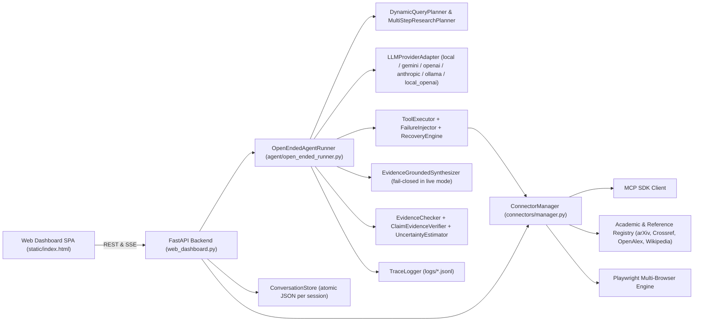

# TraceRecover — Phase 8.1 System Architecture Reference

## 1. High-Level Architecture

TraceRecover is a modular Python 3.12+ reliability and observability platform for tool-augmented LLM agents, hosted via FastAPI (`web_dashboard.py`) with an embedded light-theme web dashboard (`static/index.html`) and a deterministic CLI runner (`app.py`).

---

## 2. Module Inventory

| Layer | Key Files | Responsibility |
|---|---|---|
| **Web API & Security** | `web_dashboard.py`, `report_generator.py` | 57 FastAPI routes, CORS, security headers, body-size cap, sliding-window rate limiter, optional admin token guard, SSE streaming, PDF/CSV/JSON/Markdown exports, static SPA serving. |
| **Frontend SPA** | `static/index.html` | Single-file dashboard covering Overview, Experiments, Live Runner, Replay, Evidence Inspector, Datasets, Execution Logs, Research Reports, Settings, Query Workspace (with Execution Integrity & Claim Verification), Unseen Evaluation Lab, Multi-Provider Comparison, and Connect Hub. |
| **Adaptive Agent & Integrity** | `agent/open_ended_runner.py`, `agent/dynamic_planner.py`, `agent/research_planner.py`, `agent/provider_adapter.py`, `agent/synthesizer.py`, `agent/uncertainty_taxonomy.py`, `agent/conversation_store.py` | 10-stage open-ended execution, dynamic source selection & multi-step planning, provider health & budgets, fail-closed synthesis propagation (`SynthesisFailureError`), post-retrieval evidence preservation, atomic session-isolated conversation persistence. |
| **Core Reliability Stack *(protected)*** | `agent/react_agent.py`, `agent/planner.py`, `grounding/`, `healing/`, `uncertainty/`, `tools/`, `trace/`, `config.py` | ReAct execution, fault injection, failure detection & localization, bounded multi-strategy recovery, claim extraction & evidence grounding, optional DeBERTa NLI, uncertainty estimation, and abstention policy. |
| **Connector & Research Ecosystem** | `connectors/manager.py`, `connectors/permissions.py`, `connectors/registry.py`, `connectors/mcp/`, `connectors/sources/`, `connectors/browser/engine.py`, `connectors/api/custom_api.py` | Encrypted Fernet secret vault, SSRF/DNS-rebinding `PermissionEngine`, trust-tiered scholarly connectors (`arXiv`, `Crossref`, `OpenAlex`, `Wikipedia`), Playwright multi-browser inspection, MCP stdio/HTTP clients, custom REST APIs. |
| **Evaluation & Benchmarks** | `eval/`, `data/`, `results/` | Canonical 100-task benchmark (`eval/tasks.json`), frozen 92-question Phase 7.4 holdout (`data/phase7_4_independent_holdout.json`), statistical validation, SVG plot generation, and preserved experiment runs under `results/`. |

---

## 3. Storage & Persistence Topology

All runtime state is persisted to configurable directories (overridable via environment variables for mounted volumes):

- `TRACERECOVER_CONVERSATIONS_DIR` (default `logs/conversations`): Per-session atomic JSON files (`<session_id>/<conversation_id>.json`) shared through a cached, lock-protected `ConversationStore`. Survives restarts.
- `TRACERECOVER_LOGS_DIR` (default `logs`): Replayable JSONL execution traces plus failure, recovery, grounding, and uncertainty JSON sidecars.
- `TRACERECOVER_RESULTS_DIR` (default `results`): Timestamped benchmark runs, unseen evaluations, provider comparisons, and SVG plots.
- `TRACERECOVER_DATASET_VERSIONS_DIR` (default `data/versions`): Imported versioned custom datasets (canonical `eval/tasks.json` is never overwritten).
- `TRACERECOVER_CONNECTORS_DIR` (default `data/connectors`): Connector registry JSON, execution logs, browser artifacts, and Fernet-encrypted `vault.enc.json`.

---

## 4. Observability & Execution Modes

Every open-ended query records `trace_id`, `query_id`, `conversation_id`, `execution_mode`, `execution_mode_label`, `requested_provider`, `actual_provider`, `planning_status`, `connector_status`, `synthesis_status`, `answer_origin`, `fallback_used`, `failed_stage`, `failure_category`, `failure_reason`, `llm_usage`, `provenance`, `claim_evidence_report`, `uncertainty_report`, and 10-stage `execution_events`.

Supported execution modes:
- **`OFFLINE` (`local`)**: Deterministic local tools & synthesizer, zero network/API keys required.
- **`LIVE CONNECTOR`**: Deterministic planner/synthesizer paired with live scholarly/web/browser connectors.
- **`MOCK`**: Injected mock LLM clients or mock search adapters for deterministic testing; never labeled `LIVE LLM`.
- **`LIVE LLM` / `LIVE CONNECTOR + LIVE LLM`**: Official remote/local-server LLM adapters (`gemini`, `openai`, `anthropic`, `ollama`, `local_openai`), fail-closed when credentials are absent or synthesis fails.

