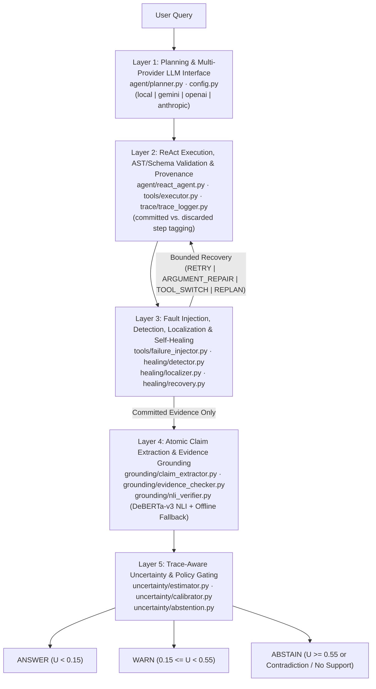

# TraceRecover — Complete Project Dossier & Technical Handoff

**Full Project Title:** *An Evidence-Grounded Self-Healing and Uncertainty-Aware Framework for Reliable Tool-Augmented Large Language Model Agents*  
**Working Name:** TraceRecover  
**Repository Path:** `C:\tracerecover`  
**Runtime Stack:** Windows 11 · Python 3.14.4 (`.\venv\Scripts\python.exe`) · FastAPI + Uvicorn · Material Design 3 Web Dashboard  
**Flagship Benchmark Run:** `phase8-run-20261123T183333634001Z` (`100` tasks, `dataset_version = 2.0`, `seed = 42`, SHA-256 `7e3a535c6609021ace84acc86e62fbc641ca6f567feac77a2d5b457f61f5050c`)

---

## 1. Executive Overview & Problem Statement

Tool-augmented Large Language Model (LLM) agents extend foundation models beyond static parametric weights by invoking external calculators, code interpreters, knowledge-base searches, ticketing APIs, and web connectors to resolve multi-hop queries. In real-world execution, however, standard ReAct-style agents fail across four coupled reliability dimensions:

1. **Silent Tool Fault Propagation:** Transient timeouts, empty tool responses, schema-violating arguments, and silently corrupted numeric outputs (`wrong_output`) flow directly into subsequent reasoning steps without detection or quarantine.
2. **Unverified Factual Hallucination:** When a tool fails, returns partial data, or produces no matching record, unprotected agents routinely fabricate plausible-sounding answers instead of auditing every emitted factual claim against committed evidence.
3. **Unbounded or Provenance-Polluting Retries:** Ad-hoc retry loops risk runaway latency/cost or contaminate final grounding by allowing discarded failed step outputs to remain mixed with valid observations.
4. **Overconfident Answers on Unanswerable Queries:** Without trace-aware uncertainty estimation and selective abstention thresholds, agents emit confident assertions even when evidence is missing, unrecovered, or directly contradictory.

### How TraceRecover Solves These Failures

**TraceRecover** introduces a modular, five-layer reliability framework that wraps tool-augmented LLM execution with end-to-end provenance tracking (`committed` vs. `discarded` steps), taxonomy-guided fault detection and bounded self-healing, atomic claim-level evidence verification (DeBERTa-v3 NLI with deterministic lexical/numeric fallback), and a calibrated four-signal uncertainty policy that gates outputs into **`ANSWER`**, **`WARN`**, or **`ABSTAIN`**.

Across a 100-task deterministic multi-hop benchmark evaluated under `0%`, `20%`, and `40%` injected tool-fault regimes (`n = 300` paired runs, `seed = 42`):

- **Task Success Rate:** `100.0% / 89.0% / 79.0%` vs. Baseline `86.0% / 58.0% / 40.0%` (`+84` net paired task wins, `0` regressions, pooled paired McNemar exact **`p = 1.03 × 10⁻²⁵`**).
- **Gold-Fact Hallucination Rate:** **`0.0%`** across all three fault rates (`0/70`, `0/60`, `0/49` claim-bearing answers) vs. Baseline `13.1% / 40.4% / 57.6%`.
- **Detector-Validated Recovery Rate:** **`52.4%`** (`22/42`) at `20%` faults and **`50.7%`** (`35/69`) at `40%` faults.
- **Zero-Leakage Selective Accuracy:** **`99.4%`** (`178/179`) out-of-fold strict selective accuracy under 5-fold group-by-`task_id` cross-fitting (`abstain_recall = 100.0%`).

---

## 2. End-to-End 5-Layer System Architecture

TraceRecover separates planning, validated tool execution, bounded self-healing, claim-level grounding, and calibrated decision gating into five auditable layers:



### Layer-by-Layer Specification

#### Layer 1 — Query Planning & Multi-Provider LLM Interface (`agent/planner.py`, `config.py`)
- **`agent/planner.py`:** Provides `RuleBasedPlanner` for deterministic offline execution (`calculator`, `python_exec`, `mock_api`, `search`) alongside `build_prompt()` and `parse_decision()` for strict JSON ReAct planning with remote LLMs.
- **`config.py` (`LLMClient` & `Settings`):** Unified client supporting `local`, `gemini`, `openai`, and `anthropic` with per-call token, latency, and USD cost telemetry (`LLMCallMetrics`, `MODEL_PRICING_PER_1M`).
  - Automatically loads key-value pairs from `.env` at startup via `load_env_file()` without overriding shell environment variables.
  - Default HTTP timeout is **`45.0` seconds** (configurable via `LLM_TIMEOUT_SECONDS` or `LLM_REQUEST_TIMEOUT`).
  - Default Gemini model is `os.getenv("GEMINI_MODEL", "gemini-3.8-flash")`. On `HTTP 404`, `HTTP 429`, `HTTP 503`, `TimeoutError`, `socket.timeout`, or `URLError`, `_complete_gemini()` automatically fails over sequentially through `("gemini-3.8-flash", "gemini-3.6-flash", "gemini-3.5-flash-lite", "gemini-2.5-flash", "gemini-2.5-flash-lite", "gemini-2.0-flash-lite")` (plus a `0.8s` backoff retry for transient `503`/`429` overload) and surfaces concise provider JSON error details without exposing secrets.

#### Layer 2 — ReAct Execution, AST/Schema Validation & Provenance Logging (`agent/react_agent.py`, `tools/executor.py`, `trace/trace_logger.py`)
- **`agent/react_agent.py` (`ReactAgent`):** Runs a bounded (`max_steps = 8`) Thought → Action → Observation → Final Answer loop, returning a rich immutable `AgentResult` linking all JSONL trace and diagnostic reports.
- **`tools/executor.py` (`ToolExecutor`):** Centralized tool registry enforcing pre-execution schema and AST safety checks (`calculator` max length `200` with strict arithmetic AST allowlist; `python_exec` max length `1000` with safe builtins `abs, len, max, min, sum` only; `mock_api` ticket regex `^T-\d+$`), deterministic caching (automatically bypassed when `failure_rate > 0`), and explicit `output_state` tagging (`committed` vs. `discarded`).
- **`trace/trace_logger.py` (`TraceLogger`):** Writes append-only structured JSONL step traces (`trace-*.jsonl`), analysis logs (`*-analysis.jsonl`), recovery logs (`*-recovery.jsonl`), and verification reports so every step is independently auditable.

#### Layer 3 — Deterministic Fault Injection, Detection, Localization & Bounded Self-Healing (`tools/failure_injector.py`, `healing/`)
- **`tools/failure_injector.py` (`FailureInjector`):** Seed-reproducible fault injector supporting `timeout`, `empty_result`, `wrong_output`, `bad_arguments`, and `tool_crash` across configurable fault rates (`0–100%`).
- **`healing/detector.py` (`FailureDetector`):** Inspects raw execution traces independent of injection labels to detect real tool failures (exceptions, timeouts, empty outputs, arithmetic mismatches, malformed schemas).
- **`healing/localizer.py` (`FailureLocalizer`):** Pinpoints root-cause failing steps and maps each detected fault to a structured failure taxonomy.
- **`healing/recovery.py` (`RecoveryEngine`):** Executes bounded self-healing strategies—**`RETRY`**, **`ARGUMENT_REPAIR`**, **`TOOL_SWITCH`** (e.g., `calculator` → `python_exec`), and **`REPLAN`**—governed by a two-tier budget: `max_retries = 1` per failure, `max_total_attempts = 4` combined attempts, and `max_duration_seconds = 15.0`. Every recovery attempt is re-validated by `FailureDetector`; failed attempts remain permanently `discarded`.

#### Layer 4 — Atomic Claim Extraction & Evidence Grounding (`grounding/`)
- **`grounding/claim_extractor.py` (`ClaimExtractor`):** Decomposes candidate answers into atomic, verifiable factual claims (filtering empty/non-alphanumeric payloads).
- **`grounding/nli_verifier.py` (`DebertaNLIVerifier`):** Runs Natural Language Inference using DeBERTa-v3 (`cross-encoder/nli-deberta-v3-small` / local weights) with a deterministic entity-scoped lexical/numerical offline fallback (`deterministic_offline_fallback`) so verification works reproducibly without external downloads.
- **`grounding/evidence_checker.py` (`EvidenceChecker`):** Audits every atomic claim **strictly against committed tool observations** (discarded/failed/injected steps are excluded as evidence), classifying each claim as `SUPPORTED`, `UNSUPPORTED`, or `CONTRADICTED` with step-ID citations and a normalized `grounding_score`.

#### Layer 5 — Trace-Aware Uncertainty Estimation & Policy Gating (`uncertainty/`)
- **`uncertainty/estimator.py` (`UncertaintyEstimator`):** Combines up to four trace reliability signals using configured weights (`DEFAULT_SIGNAL_WEIGHTS`):
  - `grounding`: **`0.45`**
  - `tool_success`: **`0.25`**
  - `recovery_reliability`: **`0.15`** (with `repeated_attempt_penalty = 0.05`)
  - `self_consistency`: **`0.15`** (optional; omitted signals are never guessed—remaining weights are cleanly renormalized)
  - Computes `uncertainty_score = 1.0 - combined_reliability`.
- **`uncertainty/calibrator.py`:** Fits operating thresholds (`answer_threshold`, `abstain_threshold`) on training folds for a target abstention precision while respecting hard contradiction gates.
- **`uncertainty/abstention.py` (`AbstentionPolicy`):** Enforces hard safety gates (any contradiction, zero factual claims, zero supported claims, or missing uncertainty score forces **`ABSTAIN`**) and thresholds (default `answer_threshold = 0.15`, `abstain_threshold = 0.55`) to emit **`ANSWER`**, **`WARN`**, or **`ABSTAIN`** with human-readable explanations.

---

## 3. Complete Repository & File Structure Map

```text
C:\tracerecover\
├── config.py                         # Settings, .env autoloader, multi-provider LLMClient (404/429/503/timeout failover), token/USD cost tracking
├── web_dashboard.py                  # FastAPI backend, REST APIs, POST /api/keys (.env manager), universal POST /api/run, exports, security middleware
├── report_generator.py               # Programmatic PDF/Markdown experiment report generator
├── app.py                            # CLI entry point for single-query agent runs
├── requirements.txt                  # Python dependencies
├── Dockerfile / docker-compose.yml / render.yaml  # Container & deployment manifests
├── .env.example                      # Template listing environment variable names (never commits secrets)
│
├── agent/                            # Layer 1 & Layer 2 orchestration
│   ├── planner.py                    # RuleBasedPlanner, ReAct build_prompt() & parse_decision()
│   ├── react_agent.py                # Core 5-layer ReactAgent loop & AgentResult assembly
│   ├── dynamic_planner.py            # Multi-step adaptive planner for open-ended workflows
│   ├── research_planner.py           # Structured research decomposition planner
│   ├── open_ended_runner.py          # Open-ended execution runner with cancellation & observability
│   ├── provider_adapter.py           # Provider capability registry & health probing
│   ├── synthesizer.py                # Grounded synthesis engine with explicit execution-mode integrity
│   ├── uncertainty_taxonomy.py       # Fine-grained uncertainty/abstention reason classification
│   └── conversation_store.py         # Atomic filesystem JSON conversation persistence
│
├── tools/                            # Validated tool execution & fault injection
│   ├── executor.py                   # ToolExecutor with AST/schema guards, caching, committed/discarded tagging
│   ├── failure_injector.py           # Seeded FailureInjector & FailureType enum
│   ├── calculator.py                 # Safe AST-checked arithmetic evaluator
│   ├── python_exec.py                # Sandboxed expression evaluator (allowlisted builtins only)
│   ├── search_tool.py                # Deterministic local factual & enterprise telemetry knowledge base
│   ├── mock_api.py                   # Simulated enterprise SLA ticket API (T-401, etc.)
│   └── external_search.py            # ExternalSearchAdapter (Wikipedia / DuckDuckGo / Tavily / SerpAPI)
│
├── trace/                            # Structured step provenance logging
│   └── trace_logger.py               # Append-only JSONL trace, analysis, recovery & grounding writers
│
├── healing/                          # Layer 3 self-healing subsystem
│   ├── detector.py                   # Independent trace-based FailureDetector
│   ├── localizer.py                  # Root-cause step FailureLocalizer & taxonomy mapper
│   └── recovery.py                   # Bounded RecoveryEngine (RETRY, ARGUMENT_REPAIR, TOOL_SWITCH, REPLAN)
│
├── grounding/                        # Layer 4 evidence verification subsystem
│   ├── claim_extractor.py            # Atomic factual ClaimExtractor
│   ├── nli_verifier.py               # DebertaNLIVerifier + deterministic offline fallback
│   └── evidence_checker.py           # Committed-evidence-only EvidenceChecker & contradiction detector
│
├── uncertainty/                      # Layer 5 calibration & selective abstention
│   ├── estimator.py                  # 4-signal UncertaintyEstimator with dynamic weight renormalization
│   ├── calibrator.py                 # Precision-targeted threshold optimizer
│   └── abstention.py                 # Hard-gated ANSWER / WARN / ABSTAIN AbstentionPolicy
│
├── connectors/                       # External connector registry, permissions & health checks
│   ├── manager.py / registry.py / permissions.py / health.py / schemas.py
│
├── eval/                             # Reproducible benchmarking, ablations, plotting & statistics
│   ├── tasks.json                    # Canonical 100-task multi-hop benchmark (dataset_version=2.0)
│   ├── runner.py / run_baseline.py / run_tracerecover.py / run_all.py
│   ├── metrics.py                    # Wilson 95% CI, hallucination, recovery, abstention & ECE metrics
│   ├── statistical_validation.py     # Paired McNemar exact test, Brier/ECE, 5-fold group-by-task_id CV
│   ├── plot_results.py               # Generates the 6 publication SVG charts
│   ├── unseen_eval.py                # Unseen dataset evaluation runner
│   └── phase4..phase8_2 validation scripts
│
├── finetuning/                       # Standalone 4-bit QLoRA recovery-policy extension
│   ├── prepare_qlora_dataset.py      # 80/20 task-grouped split (0 overlap) from step telemetry CSV
│   └── train_qlora_policy.py         # Qwen/Qwen2.5-7B-Instruct 4-bit NF4 QLoRA trainer + CPU --dry-run
│
├── static/                           # Simplified 6-page Material Design 3 light-theme UI
│   └── index.html                    # Self-contained offline-ready HTML/CSS/JS dashboard
│
├── data/                             # Installed benchmark & telemetry datasets
│   ├── tracerecover_synthetic_benchmark_100.json  # Synchronized 100-task benchmark archive
│   ├── tracerecover_execution_telemetry.csv       # 600 run-level rows (100 tasks × 3 rates × 2 systems)
│   ├── tracerecover_step_level_telemetry.csv      # 1,769 granular step-level execution rows
│   ├── qlora_train.jsonl                          # 934 task-grouped QLoRA training examples (80 tasks)
│   ├── qlora_val.jsonl                            # 235 task-grouped QLoRA validation examples (20 tasks)
│   └── phase6 / phase7 unseen & holdout datasets
│
├── results/
│   └── phase8-run-20261123T183333634001Z/         # Flagship 100-task run artifacts + 6 SVG plots
│
├── docs/                             # Technical reports & handoff documentation
│   ├── FINAL_PROJECT_REPORT.md
│   └── TRACERECOVER_COMPLETE_PROJECT_HANDOFF.md   # This comprehensive handoff dossier
│
└── tests/                            # Automated unit, integration, security & validation test suite
    ├── test_abstention.py, test_calibrator.py, test_claim_extractor.py, test_detector.py,
    ├── test_evaluation.py, test_evidence_checker.py, test_executor.py, test_failure_injector.py,
    ├── test_llm_client.py, test_localizer.py, test_metrics.py, test_nli_verifier.py,
    ├── test_phase1.py, test_phase8_evaluation_tools.py, test_recovery.py, test_uncertainty.py,
    └── test_web_dashboard.py (+ Phase 3–8.3 integration/security/performance suites)
```

---

## 4. Datasets & Telemetry Artifacts

All four core benchmark and telemetry artifacts are installed, checksum-verified (`telemetry_csv_parity.parity_ok = True`, `0` mismatches), and browsable directly inside **Tab 4: Datasets** of the web dashboard:

| Artifact Path | Records | Description |
| :--- | :--- | :--- |
| `eval/tasks.json` | **100 tasks** | Canonical frozen benchmark (`dataset_version = 2.0`, SHA-256 `7e3a535c6609021ace84acc86e62fbc641ca6f567feac77a2d5b457f61f5050c`). |
| `data/tracerecover_synthetic_benchmark_100.json` | **100 tasks** | Synchronized `data/` archive containing oracle tool plans, expected facts, and contradiction traps. |
| `data/tracerecover_execution_telemetry.csv` | **600 rows** | Run-level telemetry across `100` tasks × `3` fault rates (`0%`, `20%`, `40%`) × `2` systems (`baseline`, `tracerecover`). |
| `data/tracerecover_step_level_telemetry.csv` | **1,769 rows** | Granular per-step tool calls, injected failure types, recovery strategies, latencies, and final synthesis steps (`1,169` tool steps + `600` `final` rows). |

### 100-Task Category Breakdown (`eval/tasks.json`)

| Category | Total Tasks | Answerable (`should_abstain = False`) | Abstention Required (`should_abstain = True`) | Primary Capability Tested |
| :--- | :---: | :---: | :---: | :--- |
| `multi_hop_search_math` | 20 | 20 | 0 | Multi-hop KB lookup chained into arithmetic calculation (`search` → `calculator`). |
| `multi_record_api_aggregation` | 20 | 20 | 0 | Multi-ticket enterprise API lookups aggregated with numeric computation (`mock_api` → `calculator`). |
| `argument_repair_tool_switch` | 20 | 20 | 0 | Fault recovery via argument normalization and cross-tool failover (`calculator` ↔ `python_exec`). |
| `missing_evidence_abstention` | 20 | 0 | 20 | Queries targeting missing entities/tickets where any non-abstained claim is a hallucination. |
| `numeric_contradiction_trap` | 20 | 10 | 10 | Conflicting numeric observations testing entity-scoped contradiction detection and safe abstention. |
| **Total** | **100** | **70** | **30** | Balanced 70/30 answerable-vs-abstention reliability evaluation. |

---

## 5. Flagship 100-Task Experimental Results & Ablation Study

All metrics below are verified verbatim from `results/phase8-run-20261123T183333634001Z/comparison_summary.json`, `metrics_summary.csv`, and `statistical_validation_report.json` (`seed = 42`, `100` tasks per regime).

### 5.1 Baseline vs. TraceRecover Across Fault Regimes

| Fault Rate | System | Task Success Rate (95% Wilson CI) | Gold-Fact Hallucination Rate | Validated Recovery Rate | Abstention Recall | Avg Latency (ms) |
| :---: | :--- | :--- | :--- | :--- | :---: | :---: |
| **0%** | Baseline | `86.0%` (`86/100`, `[77.9%, 91.5%]`) | `13.1%` (`13/99`) | `0.0%` (`0/10`) | `0.0%` | `2.70 ms` |
| **0%** | **TraceRecover** | **`100.0%`** (`100/100`, `[96.3%, 100.0%]`) | **`0.0%`** (`0/70`) | `—` (`0/10` unrecoverable) | **`100.0%`** | `6.65 ms` |
| **20%** | Baseline | `58.0%` (`58/100`, `[48.2%, 67.2%]`) | `40.4%` (`40/99`) | `0.0%` (`0/42`) | `0.0%` | `2.16 ms` |
| **20%** | **TraceRecover** | **`89.0%`** (`89/100`, `[81.4%, 93.7%]`) | **`0.0%`** (`0/60`) | **`52.4%`** (`22/42`) | **`100.0%`** | `6.71 ms` |
| **40%** | Baseline | `40.0%` (`40/100`, `[30.9%, 49.8%]`) | `57.6%` (`57/99`) | `0.0%` (`0/75`) | `0.0%` | `2.14 ms` |
| **40%** | **TraceRecover** | **`79.0%`** (`79/100`, `[70.0%, 85.8%]`) | **`0.0%`** (`0/49`) | **`50.7%`** (`35/69`) | **`100.0%`** | `6.93 ms` |

*Denominator Note:* On one baseline abstention task (`MEA-20`), the raw emitted string is `"{}"` (zero alphanumeric factual claims), yielding `99` claim-bearing baseline answers per regime.

### 5.2 Component Ablation Study (`metrics_summary.csv`)

Disabling each protection layer independently confirms that grounding, uncertainty gating, and fault localization/healing are each indispensable:

| System Variant | Task Success (`0% / 20% / 40%`) | Hallucination (`0% / 20% / 40%`) | Recovery (`20% / 40%`) | Abstention Recall (`0% / 20% / 40%`) | Impact of Removal |
| :--- | :---: | :---: | :---: | :---: | :--- |
| **Full TraceRecover** | **`100.0% / 89.0% / 79.0%`** | **`0.0% / 0.0% / 0.0%`** | **`52.4% / 50.7%`** | **`100.0% / 100.0% / 100.0%`** | Full zero-hallucination reliability across all fault levels. |
| `without_grounding` | `90.0% / 79.0% / 70.0%` | `11.1% / 12.5% / 14.9%` | `52.4% / 50.7%` | `33.3% / 33.3% / 43.3%` | Contradictions & unsupported claims escape detection; abstention recall collapses from `100%` to `33–43%`. |
| `without_uncertainty` | `80.0% / 69.0% / 57.0%` | `20.0% / 30.0% / 43.0%` | `52.4% / 50.7%` | `0.0% / 0.0% / 0.0%` | Agent never abstains; unrecoverable tool errors and missing entities become hallucinations (`43.0%` at `40%` faults). |
| `without_localization` | `100.0% / 73.0% / 53.0%` | `0.0% / 18.5% / 36.4%` | `0.0% / 0.0%` | `100.0% / 96.7% / 83.3%` | Self-healing drops to `0.0%`; task success drops `-26.0` pp at `40%` faults and hallucination jumps to `36.4%`. |
| `baseline` | `86.0% / 58.0% / 40.0%` | `13.1% / 40.4% / 57.6%` | `0.0% / 0.0%` | `0.0% / 0.0% / 0.0%` | Unprotected cascading failures under tool fault injection. |

### 5.3 Generated Publication Plots (`results/phase8-run-20261123T183333634001Z/plots/`)

1. `task_success.svg` — Task Success Rate vs. Failure Rate (with 95% Wilson CI)
2. `hallucination_rate.svg` — Hallucination Rate vs. Failure Rate
3. `recovery_rate.svg` — Detector-Validated Recovery Rate
4. `calibration.svg` — Confidence Calibration Reliability Diagram (10-bin ECE)
5. `ablation_success.svg` — Ablation Study: Task Success Across Regimes
6. `average_latency.svg` — Average End-to-End Execution Latency

---

## 6. Statistical Validation & Zero-Leakage Verification (`eval/statistical_validation.py`)

All inferential statistics and cross-fitted abstention audits are persisted in `results/phase8-run-20261123T183333634001Z/statistical_validation_report.json`:

### 6.1 Paired McNemar Exact Significance Tests

| Condition | Paired Runs (`n`) | Both Correct (`n11`) | Baseline Only (`n10`) | TraceRecover Only (`n01`) | Both Wrong (`n00`) | Exact Two-Sided `p`-value | Continuity-Corrected $\chi^2$ |
| :--- | :---: | :---: | :---: | :---: | :---: | :---: | :---: |
| **0% Faults** | `100` | `86` | `0` | `14` | `0` | `1.22 × 10⁻⁴` | `12.07` |
| **20% Faults** | `100` | `58` | `0` | `31` | `11` | `9.31 × 10⁻¹⁰` | `29.03` |
| **40% Faults** | `100` | `40` | `0` | `39` | `21` | `3.64 × 10⁻¹²` | `37.03` |
| **Pooled All Rates** | **`300`** | **`184`** | **`0`** | **`84`** | **`32`** | **`1.03 × 10⁻²⁵`** | **`82.01`** |

- **Zero Regressions:** Across all `300` paired executions, `baseline_only_n10 = 0`—TraceRecover never fails a task that the baseline gets right, while winning **+84 additional tasks**.

### 6.2 Proper Calibration & 5-Fold Group-by-`task_id` Cross-Fitting

- **Brier Score:** `0.1517` (`0%`), `0.1638` (`20%`), `0.1793` (`40%`), and **`0.1649`** pooled (`n = 300`).
- **Expected Calibration Error (10-bin equal-width ECE):** `0.1964` (`0%`), `0.2125` (`20%`), `0.2348` (`40%`), and **`0.2116`** pooled (`n = 300`).
- **5-Fold Stratified Group-by-`task_id` Cross-Fitting (`target_abstain_precision = 0.85`, `seed = 42`, zero task overlap):**
  - Each fold trains thresholds on `80` tasks (`240` runs) and evaluates strictly on `20` held-out tasks (`60` runs).
  - Mean fitted thresholds: `answer_threshold = 0.2312 ± 0.0421`, `abstain_threshold = 0.3214 ± 0.0000`.
  - **Out-of-Fold Strict Selective Accuracy:** **`99.4%`** (`0.9944`, `178/179` non-abstained runs: `178` `ANSWER`, `1` `WARN`, `121` `ABSTAIN`).
  - **Out-of-Fold Abstention Metrics:** `abstain_recall = 100.0%`, `abstain_precision = 74.4%`, `abstain_f1 = 85.3%`—matching the default `0.15 / 0.55` thresholds on strict selective accuracy (`99.4%`), verifying zero threshold overfitting.

---

## 7. Simplified 6-Page Material Design 3 Web Dashboard (`web_dashboard.py` + `static/index.html`)

The presentation web application is a clean, offline-ready, light-theme Material Design 3 interface served by FastAPI (`web_dashboard.py`) with zero external font/CDN dependencies, zero `localStorage` secret persistence, and default selection of flagship run `phase8-run-20261123T183333634001Z`.

### The 6 Dashboard Pages

| Page | Purpose & Interactive Features |
| :--- | :--- |
| **1. Overview** | Displays the 5-stage reliability pipeline cards, flagship KPIs (`100% / 89% / 79%` success, `0.0%` hallucination, recovery rates, McNemar `p = 1.03e-25`), comparative grouped SVG bar chart, and installed dataset status. |
| **2. Live Demo** | Collapsible **API Keys & Model Provider** card (live masked status pills `Ready ****XXXX` vs. `Not Set`, provider selector, password-masked key input, **Save Key to .env** button), 4 one-click reliability presets (`Normal Grounded ANSWER`, `40% Fault + Self-Healing`, `Missing Evidence ABSTAIN`, `Contradiction Guard`), universal multi-line question box (`Ctrl+Enter`), active **Model Provider** dropdown (defaults to `recommended_provider`), fault slider, 5-step visual pipeline flow, and step provenance timeline. |
| **3. Results & Charts** | Statistical validation KPI strip (`1.03e-25`, `99.4%` OOF selective accuracy, Brier, ECE), Baseline vs. TraceRecover 0/20/40% table, full 15-row ablation table, and all 6 publication SVG plots. |
| **4. Datasets** | Record-count KPI cards and searchable interactive table previews for the 100-task benchmark, 600-row execution telemetry CSV, and 1,769-row step-level telemetry CSV. |
| **5. Execution Logs** | Decision-filterable (`ALL` / `ANSWER` / `WARN` / `ABSTAIN`) persisted JSONL trace browser with click-to-inspect `committed` vs. `discarded` step provenance. |
| **6. Research Report** | Live Markdown experiment report preview with one-click **Download CSV**, **Download JSON**, and **Export PDF Report** buttons. |

### Key REST API Endpoints (`web_dashboard.py`)

- `GET /api/health` & `GET /api/settings` — Subsystem health, `recommended_provider`, and masked provider key status (`configured`, `last4: "****XXXX"` — raw secrets are never returned).
- `POST /api/keys` — Validates provider (`gemini`, `openai`, `anthropic`) and key format (rejecting newlines/control chars), atomically updates `.env` while preserving existing lines, sets `os.environ[ENV_VAR]` immediately, and returns masked confirmation.
- `POST /api/run` — Executes `ReactAgent` with `auto` (resolves to `recommended_provider`), `gemini`, `openai`, `anthropic`, or `local`. Automatically augments `search` with safe Wikipedia/DuckDuckGo snippet fallback (`ExternalSearchAdapter`) for general open-domain questions while keeping explicit missing-entity/contradiction safety traps (`unobtainium`, `T-999`, `contradiction_probe`, etc.) strictly abstaining. Returns clean HTTP `504`/`502` JSON on upstream timeouts/connection faults instead of HTTP `500` tracebacks.
- `GET /api/analytics`, `GET /api/experiments`, `GET /api/traces`, `GET /api/dataset-preview`, `GET /api/export/{csv|json|report|pdf}` — Read-only analytics, trace inspection, and artifact exports with CSP/nosniff/X-Frame-Options security headers and sliding-window rate limiting.

---

## 8. Standalone 4-Bit QLoRA Fine-Tuning Extension (`finetuning/`)

To demonstrate how TraceRecover's deterministic recovery heuristics can be distilled into a compact neural recovery-policy adapter without altering the verified core engine, a standalone QLoRA pipeline was built under `finetuning/`:

### 8.1 Leakage-Free Dataset Preparation (`finetuning/prepare_qlora_dataset.py`)
- **Input:** `data/tracerecover_step_level_telemetry.csv` (`1,769` total rows → `1,169` tool-step rows after excluding `600` synthetic `final` synthesis rows).
- **Task-Grouped Split (`seed = 42`):** Stratified 80/20 split grouped strictly by `task_id` (**`task_id_overlap = 0`**):
  - `data/qlora_train.jsonl`: **`934` examples** across **`80` unique tasks** (`failure_type`: `none: 787`, `timeout: 52`, `bad_arguments: 38`, `empty_result: 32`, `wrong_output: 25`; `recovery_action`: `PROCEED: 725`, `RETRY: 102`, `ARGUMENT_REPAIR: 54`, `TOOL_SWITCH: 32`, `ABSTAIN: 20`, `REPLAN: 1`).
  - `data/qlora_val.jsonl`: **`235` examples** across **`20` unique tasks** (`failure_type`: `none: 186`, `empty_result: 22`, `timeout: 10`, `wrong_output: 10`, `bad_arguments: 7`; `recovery_action`: `PROCEED: 159`, `RETRY: 44`, `ABSTAIN: 12`, `TOOL_SWITCH: 11`, `ARGUMENT_REPAIR: 9`).
- **Supervision Target:** Chat-format JSONL predicting structured `{"failure_type", "recovery_action", "rationale"}` from step telemetry context.

### 8.2 4-Bit QLoRA Training Script & CPU Dry-Run (`finetuning/train_qlora_policy.py`)
Verified on CPU via `.\venv\Scripts\python.exe finetuning\train_qlora_policy.py --dry-run` (exit code `0`):

| Setting / Budget Metric | Value |
| :--- | :--- |
| **Base Model** | `Qwen/Qwen2.5-7B-Instruct` (28 layers, `d_model = 3584`, `d_ff = 18944`, GQA 28Q/4KV) |
| **Quantization** | 4-bit NF4 (`load_in_4bit = True`, `bnb_4bit_use_double_quant = True`, `compute_dtype = bfloat16`) |
| **LoRA Adapter Config** | `r = 16`, `lora_alpha = 32`, `lora_dropout = 0.05` |
| **Target Modules (7 per layer)** | `q_proj`, `k_proj`, `v_proj`, `o_proj`, `gate_proj`, `up_proj`, `down_proj` |
| **Training Schedule** | `lr = 2e-4`, `cosine` scheduler, `3` epochs, effective batch `16` (`4 × 4`), `warmup_ratio = 0.05`, `seed = 42`, `174` optimizer steps |
| **Trainable LoRA Parameters** | **`40,370,176`** (`1,441,792` per layer × 28 layers) |
| **Frozen 4-Bit Base Parameters** | `7,615,616,512` (`7,655,986,688` total with adapters) |
| **Trainable Parameter Fraction** | **`0.5273%`** |

---

## 9. Setup, Execution & Viva Demo Runbook (Windows PowerShell)

Run all commands from `C:\tracerecover`:

```powershell
# 1. Navigate to workspace & optionally activate virtual environment
cd C:\tracerecover
.\venv\Scripts\Activate.ps1

# 2. Verify dashboard, API key management, timeout/404/503 failover & LLM client tests
.\venv\Scripts\python.exe -m pytest tests/test_web_dashboard.py tests/test_llm_client.py -v

# 3. Verify all 122 core 5-layer engine & statistical evaluation unit tests
.\venv\Scripts\python.exe -m pytest tests/test_abstention.py tests/test_calibrator.py tests/test_claim_extractor.py tests/test_detector.py tests/test_evaluation.py tests/test_evidence_checker.py tests/test_executor.py tests/test_failure_injector.py tests/test_llm_client.py tests/test_localizer.py tests/test_metrics.py tests/test_nli_verifier.py tests/test_phase1.py tests/test_phase8_evaluation_tools.py tests/test_recovery.py tests/test_uncertainty.py -v

# 4. Validate QLoRA dataset split & CPU dry-run parameter budget
.\venv\Scripts\python.exe finetuning\prepare_qlora_dataset.py
.\venv\Scripts\python.exe finetuning\train_qlora_policy.py --dry-run

# 5. Start the 6-page Material Design 3 Web Dashboard on http://127.0.0.1:8000
.\venv\Scripts\python.exe -m uvicorn web_dashboard:app --host 127.0.0.1 --port 8000
```

### Configuring Optional Live LLM API Keys
- **Via Dashboard UI (Recommended during Viva):** Open `http://127.0.0.1:8000` → click **2. Live Demo** → expand **API Keys & Model Provider** → pick **Gemini** (`GEMINI_API_KEY`), **OpenAI** (`OPENAI_API_KEY`), or **Claude** (`ANTHROPIC_API_KEY`) → paste key → click **Save Key to .env**. The key is saved server-side into `.env` and activated immediately with zero server restart.
- **Via `.env` File:** Copy `.env.example` to `.env` and populate `GEMINI_API_KEY`, `OPENAI_API_KEY`, or `ANTHROPIC_API_KEY` (plus optional `GEMINI_MODEL` and `LLM_TIMEOUT_SECONDS=45`). Both `config.py` and `web_dashboard.py` auto-load `.env` on startup.

### Suggested 3-Minute Viva Demonstration Flow
1. **Tab 1 — Overview:** Show the 5-layer pipeline and flagship 100-task KPIs (`100% / 89% / 79%` success, `0.0%` hallucination, McNemar `p = 1.03e-25`).
2. **Tab 2 — Live Demo (Deterministic Presets):**
   - Click **40% Fault + Self-Healing** → watch `calculator` receive an injected `wrong_output` (`discarded`), `RecoveryEngine` switch to `python_exec` (`committed`), and emit a grounded `ANSWER`.
   - Click **Missing Evidence ABSTAIN** and **Contradiction Guard** → show hard safety gates forcing `ABSTAIN`.
   - Type an arbitrary general question (e.g., *"Who invented Python?"*) and press `Ctrl+Enter` → show real answer execution via the configured live LLM provider or safe Wikipedia/DuckDuckGo fallback.
3. **Tab 3 — Results & Charts:** Walk through the 0/20/40% comparison table, ablation table (`without_grounding`, `without_uncertainty`, `without_localization`), and the 6 SVG plots.
4. **Tab 5 & Tab 6 — Execution Logs & Research Report:** Inspect a persisted run's committed vs. discarded steps, then show one-click CSV/JSON/PDF export.

---

## 10. Honest Scope, Limitations & Future Work

For transparent academic defense and viva Q&A, the exact scope boundaries of the current build are explicitly documented:

1. **Deterministic Offline Benchmark Scope vs. Live LLM Execution:** The flagship 100-task comparison, ablations, and statistical validation (`phase8-run-20261123T183333634001Z`) were executed in deterministic local offline mode (`local` planner + deterministic entity-scoped NLI fallback) to guarantee 100% seed reproducibility (`seed = 42`) without external API quota variance. Live multi-provider execution (`gemini`, `openai`, `anthropic`) is integrated for interactive queries in `config.py` and `web_dashboard.py` (with automatic `404`/`429`/`503`/timeout failover), while large-scale live commercial LLM benchmarking remains dependent on paid/unthrottled provider quota.
2. **Conservative Over-Abstention Under Severe Faults:** At `40%` injected faults, TraceRecover maintains `0.0%` hallucination and `100.0%` abstention recall, but abstains conservatively on `21` answerable tasks whose injected faults exhausted the bounded recovery budget (`abstention_precision = 58.8%` at `40%` faults; `74.4%` pooled OOF). Adding richer cross-tool fallbacks and adaptive replanning can recover more of these tasks without sacrificing safety.
3. **ECE Calibration Metric Interpretation:** Pooled 10-bin ECE (`0.2116`) is elevated primarily because correctly abstained tasks receive deliberately low answer-confidence scores while receiving binary task-success credit (`1.0`). Decoupling answer-confidence calibration from abstention-utility calibration is a clear methodological improvement for future work.
4. **GPU Requirement for QLoRA Training:** `finetuning/train_qlora_policy.py` is fully implemented and CPU-validated (`--dry-run` verifies all `934/235` examples, zero task overlap, and exact `40,370,176` trainable parameter count), while actual 4-bit NF4 gradient optimization requires a CUDA GPU environment with `torch`, `transformers`, `peft`, and `bitsandbytes`.
5. **Legacy Multi-Tab Playwright UI Tests:** Streamlining `static/index.html` to strictly 6 clean presentation pages intentionally removed 8 legacy developer tabs (`workspace`, `connecthub`, `unseen`, `compare`, `experiments`, `replay`, `evidence`, `settings`). All backend REST endpoints remain intact and all non-browser unit/API tests pass (`215` tests passing across core + backend suites, including `17/17` in `test_web_dashboard.py` + `test_llm_client.py`), while the 11 legacy Phase 2–8.3 browser E2E scripts targeting those removed tabs remain retired unless updated for the 6-page layout.
6. **Future Directions:** Full GPU fine-tuning and closed-loop evaluation of the QLoRA recovery policy against `RecoveryEngine`, multi-turn long-horizon coding/research benchmarks on live web corpora, and post-hoc isotonic/temperature recalibration of abstention probabilities.
