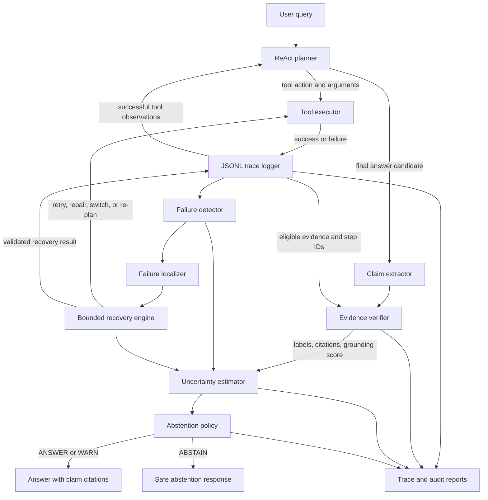

# TraceRecover System Architecture

TraceRecover keeps evidence and reliability analysis outside the answer
generator. The agent may propose an answer, but the grounding component checks
its claims against eligible tool outputs before an answer is released.

## Pipeline

## Evidence lifecycle

1. **Execution and logging:** every tool step is recorded with its arguments,
   result/error, timing, and step ID.
2. **Failure handling:** failed or injected-failure observations can inform
   diagnosis and recovery, but cannot support factual claims.
3. **Recovery validation:** a result is evidence-eligible only after execution
   succeeds and the detector validates it. A failed recovery attempt is never
   evidence.
4. **Claim extraction:** the final candidate is split into atomic claims.
5. **Evidence verification:** each claim is checked against all eligible tool
   outputs. Contradictions are retained rather than hidden by supporting
   sources.
6. **Citation assignment:** citations point to the trace step IDs that support
   the claim. The system does not create citations from unsupported text.
7. **Decision:** the uncertainty estimator summarizes separate reliability
   signals. The abstention policy chooses ANSWER, WARN, or ABSTAIN; a
   contradictory claim forces abstention.

## Main modules

| Concern | Module |
|---|---|
| Tool-augmented agent and integration | `agent/react_agent.py` |
| Provider wrapper and settings | `config.py` |
| Local/remote action planning | `agent/planner.py` |
| Tools and deterministic fault injection | `tools/` |
| Per-step trace and report persistence | `trace/trace_logger.py` |
| Failure detection, localization, and recovery | `healing/` |
| Claim extraction and evidence checking | `grounding/` |
| Reliability signals and safe final disposition | `uncertainty/` |
| Reproducible baseline, full system, metrics, and plots | `eval/` |

The Phase 7/8 evaluator controls tool actions with a deterministic
dataset-authored plan to match systems across conditions. This is useful for
testing recovery and evidence handling but does not assess open-ended planning
quality.
